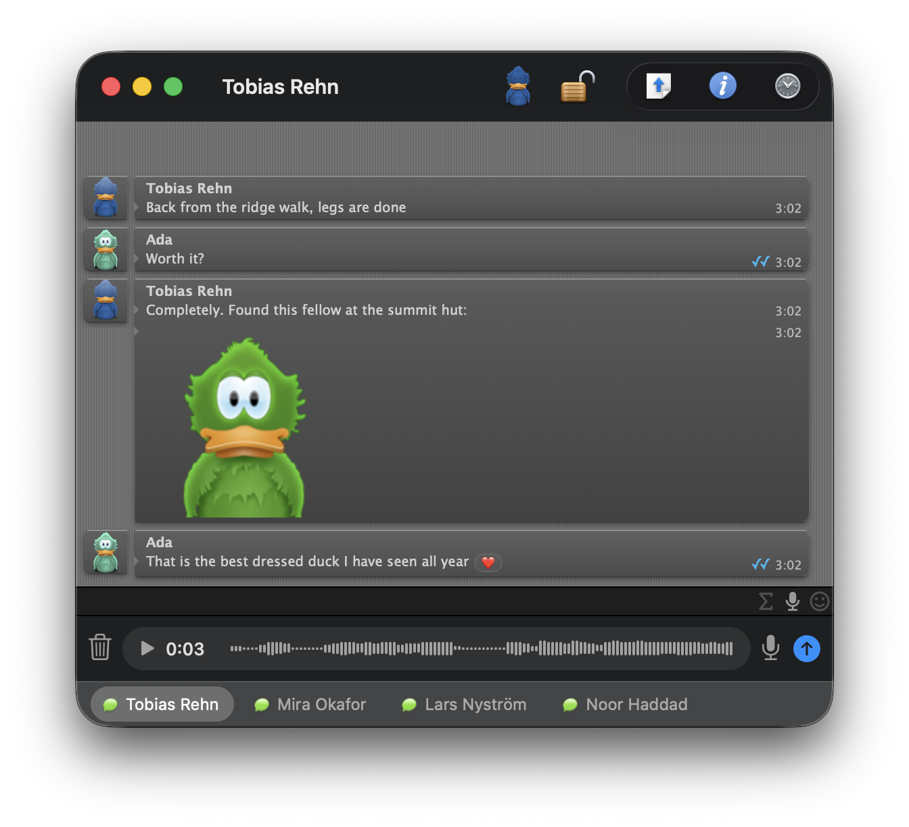
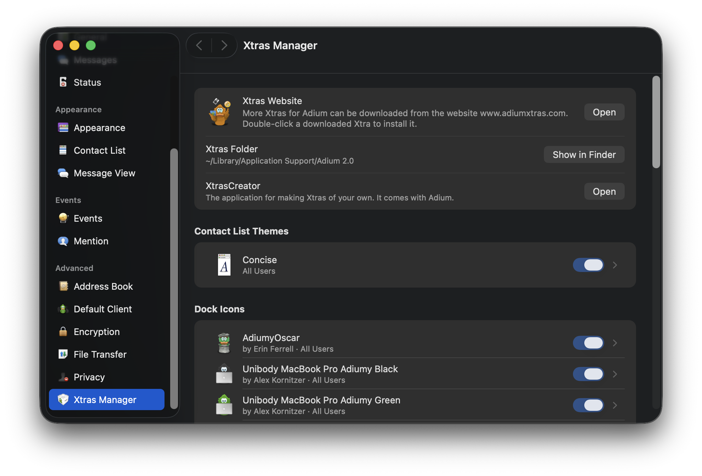

# Adium (revival fork)

This is a fork of the original [Adium](https://adium.im)
([source](https://github.com/adium/adium)) that revives and modernizes
it for current macOS. It began as an Apple Silicon (arm64) port, as
the original is an Intel-only binary from 2021. Since then much has
changed: WhatsApp, Telegram, Signal and Microsoft Teams arrived
next to the classic services that stood the test of time, encrypted
voice and video calls over XMPP, full Dark Mode, replies straight from
Notification Center banners, a rebuilt System Settings-style preferences
window, a WKWebView message view, and a long list of fixes for how
modern macOS behaves.

**Adium was created and developed by the Adium team.** All credit for
the application itself belongs to the original developers; see
[Copyright.txt](Copyright.txt). This fork is not affiliated with or
endorsed by them. It is maintained by a long-time Adium user who
simply wants to keep a beloved app alive after many years of use. The
upstream project has been inactive since 2021.

Current version: **1.8.0**.

## Original project

* Website: <https://adium.im>
* Source: <https://github.com/adium/adium>
* Last official release (Intel; on Apple Silicon it runs only through
  Rosetta 2, which Apple is phasing out):
  [Adium 1.5.10.4](https://adiumx.cachefly.net/Adium_1.5.10.4.dmg)

## What this fork changes

### Messaging and services

* WhatsApp (via
  [purple-gowhatsapp](https://github.com/hoehermann/purple-gowhatsapp)):
  QR-code device linking, inline images and voice notes, reactions,
  typing, read markers, group chats with member lists, profile
  pictures, business account names, an optional channel filter, and
  address-book names
* Telegram (via the bundled
  [tdlib-purple](https://github.com/adrighem/tdlib-purple) plugin)
  with the same everyday features, plus address-book integration
* Signal (via
  [purple-presage](https://github.com/hoehermann/purple-presage)),
  linked to your phone as an official companion device
* Microsoft Teams (via
  [purple-teams](https://github.com/EionRobb/purple-teams)), both work
  and personal accounts
* Matrix (via [purple-matrix-rs](https://github.com/iilonmasc/purple-matrix-rs),
  written for this bundle on the matrix-rust-sdk): rooms, invitations,
  history, and end-to-end encryption in both directions; signing in
  with an access token, which also covers homeservers that offer only
  SSO, such as Gitter's (see
  `Dependencies/patches/purple-matrix-rs/README.md`)
* IRC modernized: the built-in IRC protocol is replaced by
  [purple2-ircv3](https://github.com/EionRobb/purple2-ircv3), which
  speaks the same protocol plus typing notifications and other IRCv3
  capabilities
* XMPP brought forward: message carbons (XEP-0280), so a conversation
  continued on another device shows up here too; client state
  indication (XEP-0352), telling the server when Adium is in the
  background; room bookmarks synchronized with other clients
  (XEP-0402), including autojoin; delivery receipts (XEP-0184) and read
  markers (XEP-0333), the latter now requested on outgoing messages too,
  so a message you send can be confirmed delivered and then read;
  message reactions (XEP-0444), sent from the message's context menu
  and delivered to the exact message they name, in direct chats and
  rooms alike; pictures shared by modern clients through HTTP upload
  (XEP-0363, announced per XEP-0066) are shown in the conversation
  itself rather than as a bare link, governed by the same setting that
  controls automatic file transfers, including its restriction to
  contacts of your own list; and a picture you send goes the same way
  when the server offers it, uploaded per XEP-0363 and messaged as its
  address, with the classic file transfer as the fallback
* **Bonjour is back**: chatting with the people on the same network,
  with no server.
* **Voice messages**: a recorder on a shelf below the conversation,
  opened from the toolbar or from a button beside the message field.
  Record, pause, listen to it, then send it with the arrow; it goes out
  the way other clients expect it, so they play it rather than offer a
  download
* OTR migrated to the libotr 4.x API, and OMEMO (XEP-0384) added beside
  it, which is what other XMPP clients encrypt with today
* Removed services whose networks no longer exist: AIM, ICQ, MSN,
  Yahoo, Google Talk, MobileMe, LiveJournal, Sametime, Twitter, Zephyr
  and Meanwhile

Still supported classic services: **XMPP/Jabber, Bonjour, IRC,
Gadu-Gadu, Novell GroupWise and SIMPLE**, plus OTR and OMEMO encryption
and tabbed chats in a modern look.

### End to end encryption over XMPP

Conversations, Gajim, Dino and Monal encrypt with OMEMO, most of them by
default, and Adium can now read and write them.

* **Encrypted one to one conversations** (XEP-0384)
* **Every device the other person has**, shown in the encryption menu
  with its fingerprint, each one to be accepted or turned down; ours is
  at the top to be read out
* **Rather fail than fall back**: a message that cannot be encrypted
  waits, and then says so, instead of going out in the clear
* **Says what it used** so a client that cannot read the message can
  explain why (XEP-0380)
* **Pictures and voice notes are encrypted too** (XEP-0454)

Group chats are not encrypted yet.

### Voice and video calls over XMPP

Adium can place and take calls again, encrypted the way modern clients
insist on. The signalling is Adium's own, written against the XEPs; the
media runs through Google's WebRTC natively.

* **Ringing before answering** (XEP-0353)
* **Encrypted end to end with DTLS-SRTP** (XEP-0320)
* **Finding a way through and agreeing what to send**, which is most of
  what a call does before anyone hears anything (XEP-0166, XEP-0167,
  XEP-0176, XEP-0293, XEP-0294, XEP-0338, XEP-0339)
* **STUN and TURN from the account's own host** (XEP-0215)
* **Microphone and camera can be switched off mid-call** (XEP-0167's mute
  and unmute)
* **Center Stage support** Camera follows person, where possible
* **Check Call Readiness…** Check whether Adium can make or receive calls

### Dark Mode and interface

* Full Dark Mode: the application chrome follows the system
  appearance, or a light/dark choice of its own
* A rebuilt preferences window in the style of System Settings: a
  source-list sidebar, cards instead of boxed groups, and a reusable
  settings form every pane is laid out on
* Two bundled monochrome service icon sets in the plain style of
  macOS's own symbols, one for light and one for dark
* Tab tear-off works again: drag a chat out into its own window, or
  back into another, with a live preview while dragging
* A bit of nostalgia: the now-playing music status supports
  **Apple Music, Spotify and Swinsian**
* Modern window chrome, tab-bar vibrancy, and a sweep of fixes for
  focus rings, scrolling, contact-list drawing and tooltips on recent
  macOS

### JavaScript plugins for the message view

* A new xtra type: an `.AdiumPlugin` bundle carrying one JavaScript
  file that changes how messages are displayed. It works in every
  message style, needs no compiled code, and therefore never worries
  about processor architectures
* Five such plugins come bundled: **Read Receipts** draws the familiar
  ticks next to the timestamp as a sent message advances (one grey
  tick when the server has it, a grey pair once delivered, a blue pair
  once read); **Reaction Chips** gathers emoji reactions as small
  chips on the message they belong to; **Big Emoji** enlarges short
  emoji-only messages; **Markdown Light** renders the usual asterisk
  and tilde markers as bold, italic and strikethrough; **Code Blocks**
  sets backticked spans and fenced blocks in monospace
* Built security first: every plugin runs in its own isolated script
  world, the message window refuses all remote network loads, and a
  plugin only ever sees the rendered display, never the text you send,
  your logs, or the network
* XtrasCreator authors the new type, with a scaffold to start from,
  an editor, and a lint pass that catches the common mistakes

### Notifications

* Notifications go through the macOS Notification Center, replacing
  Growl
* Reply straight from the banner: message notifications carry a
  text field, and the answer is sent without ever bringing Adium
  forward

### Platform and security

* Native arm64 build; the app bundle is self-contained, with no
  Homebrew or other third-party runtime dependency
* All bundled libraries are native arm64, built from pinned sources
* Bundled libpurple upgraded from 2.12.0 (2017) to 2.14.14, on a
  current glib
* Server certificates are actually verified (SecTrust with a
  proper trust prompt) on every SSL connection, including IRC, where
  the old code silently accepted anything
* Passwords stored through the Keychain (SecItem) API
* Address book integration moved from the AddressBook framework
  to the Contacts framework, with the modern
  permission prompt; cards are matched by phone number, chat address
  or a manual link

### Localization

* String extraction caught up: hundreds of strings the app already
  showed but had never been extracted are now translatable, filled in
  across the 26 shipped languages

### Tools

* **XtrasCreator**, the companion app for making Adium xtras, rebuilt
  from scratch on a modern base (`Other/XtrasCreator`): it authors
  emoticon sets, sound sets, status/service/menu-bar/group-chat icon
  packs, dock icons, message styles, contact list themes and layouts,
  and script packs, and writes the description Adium shows on an
  xtra's page. It is built with Adium and travels inside the
  application, at `Contents/Helpers/XtrasCreator.app`.
* **Contact Pictures**, opened from the Address Book settings: the
  cards linked to your chat contacts, each with the chat picture and
  the card picture side by side, and one button that puts the chat
  picture on the card. This is the single write Adium ever makes to
  the address book, and it happens only when that button is pressed

### Adopted from the unreleased 1.6/1.7 line

Adium's development did not stop at the last state of GitHub's adium/adium:
the Mercurial mainline and community branches continued toward an
Adium 1.6/1.7 that was never released, preserved today in forks such
as [shtrom/adium](https://github.com/shtrom/adium).

* The emoticon picker in the message entry field, which replaces the
  old emoticon toolbar item. Two more buttons can stand beside it: one
  that records a voice note and one that opens the formula editor
* Room configuration window for owners of XMPP chat rooms
* OTR messages routed to the contact's most recently active device
  instead of the best-ranked one
* Transcripts split at midnight, so a chat left open for days shows
  up on every day it covers

## System requirements

* Apple Silicon Mac, macOS 13 or later
* Everything is native arm64, including all bundled dependencies
  (libpurple, glib, libotr, ...): no Homebrew required to run
* Xcode, if you build it yourself, by hand or through Homebrew

## Download

Fetch the [latest release](https://github.com/KnutMann/adium/releases/latest)
as a disk image, mount it and drag Adium into your Applications folder like
any other application. Updates are offered automatically.

## Installing with Homebrew

The tap at <https://github.com/KnutMann/homebrew-adium> installs the same
release as a cask:

	brew tap KnutMann/adium
	brew trust --tap KnutMann/adium   # Homebrew 7 loads third-party taps only once trusted
	brew install --cask KnutMann/adium/adium

Spell the tap out: Homebrew's own tap has a cask called `adium` too, and
that one is the Intel 1.5.10.4. The tap's formula builds the release from
source instead, for which it needs a full Xcode; its README says how.

## Building

One command from a fresh checkout to an installed application:

	git clone --recursive https://github.com/KnutMann/adium.git
	cd adium
	./install.sh

Dependencies are checked into the repository as prebuilt arm64
binaries. The script builds the app and offers to install it to
/Applications. `./install.sh --rebuild-dependencies` builds the bundled
libraries from source first; it needs a Homebrew toolchain, takes the
better part of an hour and is otherwise never needed.

A few things are fetched rather than vendored, and `install.sh` gets
them by running `Dependencies/fetch.sh` before it builds anything.
Building from Xcode alone does not run it, so run it once after cloning.

* the **MMTabBarView** submodule, which git clones only when asked a
  second time (`git submodule update --init --recursive`)
* Google's **WebRTC**, which carries the media of a call: the official
  Chromium build repackaged by
  [stasel/WebRTC](https://github.com/stasel/WebRTC) (version 153.0.0,
  BSD 3-Clause), checked against a pinned SHA-256 and kept out of the
  repository because it is a 200 MB binary framework
* **picomemo**, the cryptographic half of OMEMO (ISC), fetched and built
  from source at a pinned commit
* **Sparkle** 2.10.1 (MIT), the updater, fetched as the project's own signed
  release and checked against a pinned SHA-256

## License

The source in this repository is GNU GPL v2 or later, see
[License.txt](License.txt). Original code copyright the Adium team and
contributors ([Copyright.txt](Copyright.txt)).

**The application you build from it is not GPL v2**, as several of the
bundled plug-ins carry stronger terms.

* `libsignal-presage.so` is GPL v3 itself, and the Rust it links in
  statically (`presage`, `presage-store-sqlite` and
  `libsignal-service-rs`) declares **AGPL-3.0-only** in its own
  `Cargo.toml`. The Affero terms therefore reach the shipped binary.
* `libwhatsmeow.so`, `libteams.so` and `libteams-personal.so` are
  GPL v3.
* `libmatrix.so` is GPL v2 or later itself, and the matrix-rust-sdk it
  links in statically is Apache 2.0, which combines with GPL v3 and not
  with GPL v2.
* `libtelegram-tdlib.so` links the bundled OpenSSL 3, whose Apache 2.0
  terms do not combine with GPL v2 at all. The same OpenSSL is now used
  by `AdiumLibpurple` itself, for the cryptography behind OMEMO, so this
  one is no longer confined to a plug-in.

The texts those terms require to travel with the work are in
[Licenses/](Licenses): [GPL-3.0.txt](Licenses/GPL-3.0.txt) and
[AGPL-3.0.txt](Licenses/AGPL-3.0.txt).

### Bundled third-party binaries and their sources

This repository ships some components as prebuilt arm64 binaries. The
corresponding sources are publicly available at the exact revisions
listed here (the `Dependencies/patches/` directories document every
local change on top of them):

| Binary | Project | Revision | License |
| --- | --- | --- | --- |
| `PurplePlugins/libwhatsmeow.so` | [purple-gowhatsapp](https://github.com/hoehermann/purple-gowhatsapp) | `b618ef56d09f516958f89156cbdec0e9c2b82347` | GPL v3 |
| `PurplePlugins/libtelegram-tdlib.so` | [tdlib-purple](https://github.com/adrighem/tdlib-purple) 2.1.0 | `b277ac1941dbed946444454f67b89265541237b7` | GPL v2 |
| (statically inside `libtelegram-tdlib.so`) | [TDLib](https://github.com/tdlib/td) 1.8.65 | `a8f21f5230172634becc1739050ef23ecd6ea291` | Boost 1.0 |
| `PurplePlugins/libsignal-presage.so` | [purple-presage](https://github.com/hoehermann/purple-presage) | `c4c9b8d8e1a822f973520e8870aba1d2347b18c6` (nightly-20260810) | GPL v3, with **AGPL v3** parts statically linked in (see below) |
| `PurplePlugins/libteams.so`, `libteams-personal.so` | [purple-teams](https://github.com/EionRobb/purple-teams) | `62f6fff` | GPL v3 |
| `PurplePlugins/libircv3.so` | [purple2-ircv3](https://github.com/EionRobb/purple2-ircv3) | `0e73297` | GPL v2 |
| `PurplePlugins/libmatrix.so` | [purple-matrix-rs](https://github.com/iilonmasc/purple-matrix-rs), with the [matrix-rust-sdk](https://github.com/matrix-org/matrix-rust-sdk) 0.19 statically linked in | `b2fb0ce276e0d84c8495a9a7a1a955251203c052` (v0.2.1) | GPL v2+, with **Apache 2.0** parts statically linked in (see below) |
| `Frameworks/libssl.3.dylib`, `libcrypto.3.dylib`, headers under `Frameworks/openssl/include` | [OpenSSL](https://www.openssl.org) 3.5.9, used by TDLib inside the Telegram plugin and by picomemo, and compiled against by picomemo and the OMEMO media code | built by `Dependencies/build.sh` from the pinned source it fetches | Apache 2.0 |
| `Frameworks/libwebp.7.dylib`, `libsharpyuv.0.dylib` | [libwebp](https://chromium.googlesource.com/webm/libwebp) 1.6.0 | built by `Dependencies/build.sh` from the pinned source it fetches | BSD 3-Clause |
| `Frameworks/libpng16.16.dylib` | [libpng](http://www.libpng.org) 1.6.58 | built by `Dependencies/build.sh` from the pinned source it fetches | libpng/zlib |
| `Frameworks/libotr.framework`, `libgcrypt.framework`, `libgpgerror.framework` | [libotr](https://otr.cypherpunks.ca) 4.1.1, [libgcrypt](https://gnupg.org) 1.12.4, [libgpg-error](https://gnupg.org) 1.61 | built by `Dependencies/build.sh --build-otr` from the pinned sources it fetches | GPL v2 / LGPL v2.1 |
| `Frameworks/libpurple.framework`, `libglib.framework`, `libgio`, `libgobject`, `libgmodule`, `libgthread`, `libintl`, `libffi`, `libjson-glib` | [libpurple](https://pidgin.im) 2.14.14, [glib](https://gitlab.gnome.org/GNOME/glib) 2.88.3, [gettext](https://www.gnu.org/software/gettext/) 1.0, [libffi](https://sourceware.org/libffi/) 3.8.0, [json-glib](https://gitlab.gnome.org/GNOME/json-glib) 1.10.8 | built by `Dependencies/build.sh` from the pinned sources it fetches | GPL v2 / LGPL v2.1 |
| `Frameworks/libgdk_pixbuf-2.0.0.dylib`, `libjpeg.8.dylib` | [gdk-pixbuf](https://gitlab.gnome.org/GNOME/gdk-pixbuf) 2.44.7, [libjpeg-turbo](https://libjpeg-turbo.org) 3.2.0, drawing the Signal linking code and decoding Telegram stickers | built by `Dependencies/build.sh` from the pinned sources it fetches | LGPL v2.1 / BSD-style |
| `Frameworks/opus/lib/libopus.a`, `libogg.a`, `libopusfile.a` | [Opus](https://opus-codec.org) 1.5.2, [libogg](https://xiph.org/ogg/) 1.3.6, [opusfile](https://opus-codec.org) 0.12 | built by `Dependencies/opus/build-opus.sh`, tarballs pinned by SHA-256 | BSD 3-Clause |

Of the three Xiph libraries, only the first two are linked into the
application; opusfile is the reader `Testing/voice/opus-test.sh` checks
the encoder against, and ships so that the check runs from a clone.

The LGPL components are dynamically linked, so they can be swapped out
by rebuilding the bundle. The two Xiph libraries are the exception: they
are linked statically, because a codec used by one source file is not
worth a framework to embed and sign, and their licence does not ask for
it.
